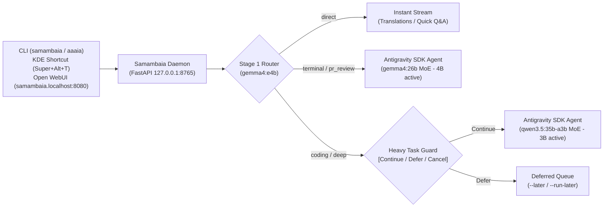

<p align="center">
  
</p>

<h1 align="center">samambAIA (<code>samambaia</code> / <code>aaaia</code>)</h1>

<p align="center">
  <em>"From each tool and model according to its ability, to each task according to its need."</em><br/>
  <strong>🇧🇷 <a href="README.pt-BR.md">Leia a documentação em Português (BR)</a></strong>
</p>

---

**Samambaia** is a **100% local** AI agent coordinator for Linux.

Just like a *samambaia* (fern) in nature — thriving in mutual aid upon the branches of larger trees without parasitizing or trying to replace them — **Samambaia** orchestrates battle-tested open tools ([Podman](https://podman.io/), [Ollama](https://ollama.com/), [Google Antigravity Python SDK](https://github.com/google-antigravity/antigravity-sdk-python), [Open WebUI](https://github.com/open-webui/open-webui), [FastAPI](https://fastapi.tiangolo.com/), and [systemd](https://systemd.io/)) so machines with modest VRAM and plenty of system RAM (e.g., **6 GB VRAM + 32+ GB RAM**) can run fast, safe agentic workflows.

## ⚙️ Default Configuration (100% Customizable)

### Default models and why they were chosen

On machines with limited GPU VRAM paired with abundant system RAM, large dense models (30B+) become sluggish because the CPU must read every parameter from RAM on each generated token. Samambaia's default setup combines **PLE (*Per-Layer Embeddings*)** and **MoE (*Mixture-of-Experts*)** architectures, delivering large-model intelligence while activating only **3B to 4.5B parameters per token** (5× to 8× faster):

| Profile | Default Model | Active / Token | Why it was chosen |
| :--- | :--- | :--- | :--- |
| **`router` & `direct`** | [`gemma4:e4b`](https://ollama.com/library/gemma4) | ~4.5B (PLE) | Classifies routes in milliseconds and streams translations/quick answers immediately (`think=False`), fitting core compute into tight VRAM while PLE tables sit in RAM. |
| **`terminal` & `pr_review`** | [`gemma4:26b`](https://ollama.com/library/gemma4) | 4B (MoE) | Rock-solid native tool calling and file/diff inspection at 4B decoding speeds without long thinking delays. |
| **`coding` & `deep`** | [`qwen3.5:35b-a3b`](https://ollama.com/library/qwen3.5) | 3B (MoE + Thinking) | Top-tier extended reasoning (*thinking*) for code and architecture while maintaining ~14–18 tokens/s in system RAM thanks to 3B active parameters. |

> Every profile is configurable via ordered fallback lists: to swap in smaller, larger, or alternative [Ollama](https://ollama.com/search) models, simply edit `model_preferences`.

### Other customizable settings

Nothing is hardcoded. Run `aaaia --init-config` to generate your personal `~/.config/samambaia/config.json` (modeled after [`config.example.json`](config.example.json)) and `aaaia --config` to inspect the active merged configuration:

- **`model_preferences`:** ordered fallback model lists for each profile (`router`, `direct`, `terminal`, `pr_review`, `coding`, and `deep`).
- **`inference`:** automatic VRAM unloading on model switch (`unload_other_models_on_switch` — set `false` on 24 GB+ GPUs), memory residency (`router_keep_alive`), context windows (`router_num_ctx`, `direct_num_ctx`), temperature, context compaction threshold (`compaction_tokens`), and timeouts.
- **`guard`:** profiles that always prompt for confirmation (`always_confirm_tiers`, default `["deep"]`), heavy model substring patterns (`heavy_model_patterns`, e.g., `35b`, `32b`), and blocked destructive shell patterns (`dangerous_command_patterns`).
- **`limits`:** maximum stored turns per session (`max_session_turns`), history context char cap, safe truncation caps for `git diff`, GitHub PR diffs, and webpages, plus default web search result count.
- **`features`:** toggle web tools (`enable_web_tools`), remote GitHub PR tools (`enable_github_pr_tools`), and customize MCP server arguments for Chrome and Firefox.
- **Endpoints, Language & Desktop:** `ollama_host`, `openwebui_url`, `public_webui_url`, `daemon_host`, `daemon_port`, `default_language`, Podman container names (`ollama_container_name`, `openwebui_container_name`), and KDE global shortcut (`kde_selection_shortcut`, default `Meta+Alt+T`). Environment variable overrides (`SAMAMBAIA_OLLAMA_HOST`, `SAMAMBAIA_DAEMON_PORT`, `SAMAMBAIA_LANGUAGE`, `SAMAMBAIA_SHORTCUT`) are also supported.
- **`zettelkasten` *(optional, disabled by default)*:** `enabled` (`false`), notes path (`directory`), task file (`todo_file`), Open WebUI collection name (`openwebui_collection_name`), and sync interval.

## ✨ Highlights

- **Two-Stage Cooperative Routing (VRAM-Aware):**
  - **Stage 1 (`router` & `direct` → `gemma4:e4b`):** Classifies intent in milliseconds via [Ollama](https://ollama.com/)'s native JSON-schema grammar and streams translations/quick answers immediately (`think=False`, zero subprocess overhead).
  - **Stage 2 (`terminal`, `pr_review`, `coding`, `deep`):** Automatically unloads idle models before loading larger specialists (preventing VRAM contention) and runs a workspace-scoped [Google Antigravity SDK](https://github.com/google-antigravity/antigravity-sdk-python) `Agent` (`$PWD`) with declarative safety policies.
- **Interactive Heavy-Task Guard & "Save for Later" Queue:**
  - Whenever a task routes to `deep`, triggers a cold load of the ~21 GB model (`qwen3.5:35b-a3b`), or involves a long multi-step audit, Samambaia warns you **before** touching RAM/VRAM: **`[C]` Continue**, **`[D]` Defer (Save for later)**, or **`[X]` Cancel** — both in the terminal and inside [Open WebUI](https://github.com/open-webui/open-webui) chat bubbles!
- **Built-in Toolset:**
  - **Live Web Search & Clean URL Reader:** `web_search` ([`ddgs`](https://pypi.org/project/ddgs/) / DuckDuckGo) and `read_webpage` ([BeautifulSoup](https://www.crummy.com/software/BeautifulSoup/)).
  - **Read-Only Code Review (Local & Remote GitHub PRs):** inspects local `git_diff`, `git_status`, `git_log` or remote PRs by number (`gh_pr_view`, `gh_pr_diff` via [GitHub CLI](https://cli.github.com/) or REST API) without switching branches or granting write/shell access.
  - **On-Demand Browser MCP:** attach [`chrome-devtools-mcp`](https://www.npmjs.com/package/chrome-devtools-mcp) (Chrome/Chromium) or [`@playwright/mcp`](https://www.npmjs.com/package/@playwright/mcp) (Firefox) via `--browser-mcp`.
  - **[Zettelkasten](https://zettelkasten.de/) *(optional)*:** setting `"zettelkasten": {"enabled": true}` enables Markdown note tools (`search_zk`, `read_zk_note`, `append_zk_todo`) and a zero-idle-RAM `systemd --user` timer that incrementally mirrors notes into Open WebUI's `#zk` Knowledge base.
- **Native Linux / [KDE Plasma](https://kde.org/plasma-desktop/) Integration:**
  - Starts on login via [systemd](https://systemd.io/) (`systemd --user`), waking up your `ollama` and `open-webui` containers.
  - System menu launcher (with minimalist icon [`assets/samambaia-icon.png`](assets/samambaia-icon.png)) and global KDE shortcut (**`Super + Alt + T`**) to translate or explain any selected screen text. *PRs welcome for other desktop environments!*

## 🏗️ Architecture



## 🚀 Installation

### 1. Prerequisites
- Linux with **Python 3.11+**, [`uv`](https://docs.astral.sh/uv/), and [Podman](https://podman.io/) (with NVIDIA CDI if using an NVIDIA GPU).
- Running [Ollama](https://ollama.com/) container (recommended flags for constrained VRAM):
  ```bash
  podman run -d --device nvidia.com/gpu=all --security-opt=label=disable \
    -e OLLAMA_FLASH_ATTENTION=1 -e OLLAMA_KV_CACHE_TYPE=q8_0 \
    -e OLLAMA_MAX_LOADED_MODELS=1 -e OLLAMA_CONTEXT_LENGTH=16384 \
    -v ollama_storage:/root/.ollama -p 11434:11434 \
    --name ollama --restart unless-stopped docker.io/ollama/ollama:latest

  podman exec ollama ollama pull gemma4:e4b
  podman exec ollama ollama pull gemma4:26b
  podman exec ollama ollama pull qwen3.5:35b-a3b
  ```
- Optional [Open WebUI](https://github.com/open-webui/open-webui) container connected to Samambaia:
  ```bash
  podman run -d --network=host --security-opt=label=disable \
    -e PORT=8080 -e WEBUI_AUTH=False \
    -e OLLAMA_BASE_URL=http://127.0.0.1:11434 \
    -e OPENAI_API_BASE_URL=http://127.0.0.1:8765/openai/v1 \
    -e OPENAI_API_KEY=samambaia -e DEFAULT_MODELS=samambaia-auto \
    -e ENABLE_WEB_SEARCH=True -e WEB_SEARCH_ENGINE=duckduckgo \
    -e WHISPER_MODEL=base \
    -v open_webui_data:/app/backend/data \
    --name open-webui --restart unless-stopped ghcr.io/open-webui/open-webui:main
  ```

### 2. Install Samambaia & Enable Boot Services
```bash
git clone https://github.com/codexico/samambaia.git
cd samambaia
uv sync
bash scripts/install.sh
```

Personal overrides live in `~/.config/samambaia/config.json` (`aaaia --init-config`), keeping the repository clean of local paths or preferences. *(Zettelkasten users can pass `bash scripts/install.sh --with-zk` or enable `zettelkasten.enabled` in config).*

## 💻 CLI Usage (`samambaia` or `aaaia`)

Why **`aaaia`**? For faster typing (`aa` + `TAB` or `sama` + `TAB` — `sam` or `smb` would collide with `samba`). Strip the consonants from `s-a-m-a-m-b-a-i-a` and you are left with its exact vowels: **`a-a-a-i-a`**!

```bash
# Daemon status, Open WebUI URL, VRAM allocation, and deferred queue
aaaia --status

# Generate and inspect your user configuration
aaaia --init-config
aaaia --config

# Instant translation ('direct' -> gemma4:e4b)
aaaia "Translate to Portuguese: Zero-copy serialization reduces memory bandwidth pressure."

# Multi-turn conversations remembering context in the current directory
aaaia "Explain what pyproject.toml configures in this project"
aaaia -c "And which web libraries do we use?"
aaaia --chat   # Interactive REPL (/new, /later, /exit)

# Web search & URL reading
aaaia "Search the web for Fedora Atomic Desktop and list the main official links"
aaaia "Read https://ollama.com/library/gemma4 and summarize the available variants"

# Read-only code review (local branch diff or remote GitHub PR #)
aaaia "Review my current branch changes"
aaaia "Review PR #42"

# Manage heavy tasks saved for later
aaaia --later
aaaia --run-later
aaaia --drop-later 1
```

## 🌐 Browser Usage (Open WebUI & MCP Automation)

### 1. Full Web Interface ([Open WebUI](https://github.com/open-webui/open-webui))
Open **`http://samambaia.localhost:8080`** in Firefox or Chrome (or press `Super`, type `samambaia`, and hit `Enter`):

- **Automatic routing in chat:** with the default **`samambaia-auto`** model selected, you get persistent multi-turn conversations, file attachments, local voice dictation (Whisper), and web search.
- **Target a local project directory from the browser:** prefix your message with `cwd:` so the agent operates inside that workspace:
  ```text
  cwd:~/projs/my-app Review my current branch changes
  ```
- **Interactive heavy-task confirmation in chat:** when a prompt requires `deep` (`qwen3.5:35b-a3b`), Samambaia replies with a warning card — send **`c`** to continue immediately, **`d`** to save it to the deferred queue (`!later` lists pending items in chat), or **`x`** to cancel.
- **Direct specialist profiles:** you can also pick `samambaia-pr-review`, `samambaia-terminal`, `samambaia-coding`, `samambaia-deep`, `samambaia-browser-firefox`, or `samambaia-browser-chrome` directly from Open WebUI's model dropdown.

### 2. Agent Controlling or Inspecting Firefox / Chrome (MCP)
When you want the agent itself to open pages, inspect the DOM, or check browser console logs:

```bash
# Firefox via Playwright MCP
aaaia --browser-mcp firefox "Open https://example.com in Firefox and report the page title and links"

# Chrome / Chromium via Chrome DevTools MCP
aaaia --browser-mcp chrome "Inspect the active Chrome tab and check for console errors"
```

## 📜 License & EULA

- Licensed under the **Open Software License v. 3.0 (OSL-3.0)** — see [`LICENSE`](LICENSE).
- Subject to the **End User License Agreement** in [`EULA`](EULA): *licensed only for natural persons, not for any legal entity, corporation, or commercial business.*
