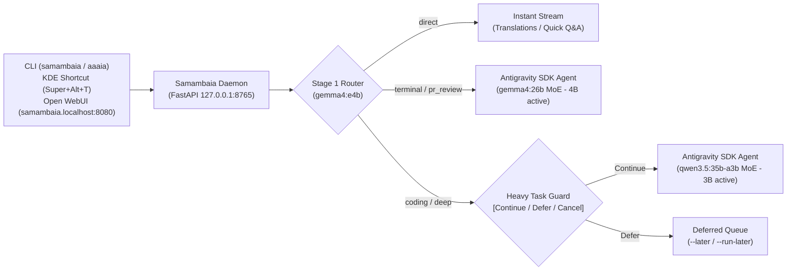

<p align="center">
  
</p>

<h1 align="center">samambAIA (<code>samambaia</code> / <code>aaaia</code>)</h1>

<p align="center">
  <em>"From each tool and model according to its ability, to each task according to its need."</em><br/>
  <strong>🇧🇷 <a href="README.pt-BR.md">Leia a documentação em Português (BR)</a></strong>
</p>

---

**Samambaia** (*fern* in Portuguese — hiding the palindrome **`AIA`**: *Artificial Intelligence Artificial* / *Artificial Inteligência Artificial*, and shipping with its vowel-only fast alias **`aaaia`**) is a 100% local, cooperative AI agent coordinator for Linux.

Like an epiphytic fern in nature — thriving symbiotically on the branches of larger trees without parasitizing or replacing them — **Samambaia** orchestrates best-in-class open tools (**Podman**, **Ollama**, **Google Antigravity Python SDK**, **Open WebUI**, **systemd**, and your **Zettelkasten** Markdown vault) so that constrained consumer GPUs (e.g., **6 GB VRAM + 32–64 GB System RAM**) deliver fast, reliable agentic workflows.

## ✨ Highlights

- **Two-Stage Cooperative Routing (VRAM-Aware):**
  - **Stage 1 (`router` & `direct` → `gemma4:e4b`):** Classifies intent via native JSON-schema grammar in milliseconds and streams translations/quick answers immediately with `think=False` and zero subprocess overhead.
  - **Stage 2 (`terminal`, `pr_review`, `coding`, `deep`):** Automatically unloads idle models when switching tiers so models never fight over limited VRAM, then launches a workspace-scoped **Google Antigravity SDK `Agent`** with declarative safety policies.
- **Interactive Heavy-Task Guard & "Save for Later" Queue:**
  - Whenever a prompt triggers `deep` mode, a cold load of a heavy ~21 GB model (`qwen3.5:35b-a3b`), or a multi-step audit, Samambaia warns you **before** touching RAM/VRAM: **`[C]` Continue**, **`[D]` Defer (Save for later)**, or **`[X]` Cancel** — both in the terminal and inside Open WebUI chat bubbles!
- **Rich Built-in Toolset:**
  - **Live Web Search & Reader:** DuckDuckGo search (`web_search`) + clean HTML extraction (`read_webpage`).
  - **Read-Only Local & Remote PR Reviewer:** Inspects local diffs (`git_diff`, `git_status`, `git_log`) and remote GitHub PRs by number (`gh_pr_view`, `gh_pr_diff`) without switching branches or granting write/shell permissions.
  - **Zettelkasten (`~/zk`) Integration:** Live `search_zk`, `read_zk_note`, `append_zk_todo` tools **plus** a zero-RAM `systemd --user` timer that incrementally mirrors `~/zk` into Open WebUI's `#zk` vector Knowledge base.
  - **On-Demand Browser MCP:** Attach `chrome-devtools-mcp` (Chromium/Chrome) or `@playwright/mcp --browser firefox` (Firefox) via `--browser-mcp`.
- **Linux Desktop Native:**
  - Starts automatically on login (`systemd --user`), waking up your Podman `ollama` and `open-webui` containers.
  - Includes a desktop app launcher and a global KDE Wayland shortcut (**`Super + Alt + T`**) to translate or explain any selected text on screen.

## 🏗️ Architecture



## 🧠 Default 2026 Model Trio (Tuned for 6 GB VRAM + 64 GB RAM)

By pairing a tight GPU with abundant system RAM, **Mixture-of-Experts (MoE)** and **Per-Layer Embedding (PLE)** models run 5×–8× faster than dense 32B models because only 3B–4.5B parameters are active per token:

| Profile | Default Model | Active Params | Role |
| :--- | :--- | :--- | :--- |
| **`router` & `direct`** | `gemma4:e4b` | ~4.5B (PLE) | Sub-second routing, screen-selection translations, quick answers. |
| **`terminal` & `pr_review`** | `gemma4:26b` | 4B (MoE) | Linux commands, web search, `~/zk` notes, and read-only PR reviews. |
| **`coding` & `deep`** | `qwen3.5:35b-a3b` | 3B (MoE + Thinking) | Code generation/refactoring and deep architectural analysis. |

## 🚀 Installation

### 1. Prerequisites
- Linux with **Python 3.11+**, [`uv`](https://docs.astral.sh/uv/), and **Podman** (with NVIDIA CDI if using an NVIDIA GPU).
- Running `ollama` container (recommended flags for constrained VRAM):
  ```bash
  podman run -d --device nvidia.com/gpu=all --security-opt=label=disable \
    -e OLLAMA_FLASH_ATTENTION=1 -e OLLAMA_KV_CACHE_TYPE=q8_0 \
    -e OLLAMA_MAX_LOADED_MODELS=1 -e OLLAMA_CONTEXT_LENGTH=16384 \
    -v ollama_storage:/root/.ollama -p 11434:11434 \
    --name ollama --restart unless-stopped docker.io/ollama/ollama:latest

  podman exec ollama ollama pull gemma4:e4b
  podman exec ollama ollama pull gemma4:26b
  podman exec ollama ollama pull qwen3.5:35b-a3b
  ```
- Optional **Open WebUI** container connected to Samambaia:
  ```bash
  podman run -d --network=host --security-opt=label=disable \
    -e PORT=8080 -e WEBUI_AUTH=False \
    -e OLLAMA_BASE_URL=http://127.0.0.1:11434 \
    -e OPENAI_API_BASE_URL=http://127.0.0.1:8765/openai/v1 \
    -e OPENAI_API_KEY=samambaia -e DEFAULT_MODELS=samambaia-auto \
    -e ENABLE_WEB_SEARCH=True -e WEB_SEARCH_ENGINE=duckduckgo \
    -e WHISPER_MODEL=base \
    -v open_webui_data:/app/backend/data \
    --name open-webui --restart unless-stopped ghcr.io/open-webui/open-webui:main
  ```

### 2. Install Samambaia & Enable Boot Services
```bash
git clone https://github.com/codexico/samambaia.git
cd samambaia
uv sync
bash scripts/install.sh
```

Personal overrides can be placed in `~/.config/samambaia/config.json` (modeled after [`config.example.json`](config.example.json)) without touching tracked files.

## 💻 CLI Usage (`samambaia` or `aaaia`)

Why `aaaia`? Strip the consonants from `s-a-m-a-m-b-a-i-a` and you get its exact vowels in order: **`aaaia`**!

```bash
# Check daemon, Open WebUI, VRAM allocation, and deferred queue
aaaia --status

# Quick translation (auto-routes to 'direct' -> gemma4:e4b)
aaaia "Translate to Portuguese: Zero-copy serialization reduces memory bandwidth pressure."

# Multi-turn conversations in the current directory
aaaia "Explain what pyproject.toml configures in this project"
aaaia -c "Which web dependencies did we include?"
aaaia --chat   # Interactive REPL (/new, /later, /exit)

# Web search, URL reading & Zettelkasten notes
aaaia "Search the web for Fedora Atomic Desktop docs and list the top links"
aaaia "What notes do I have about DNS in my zk?"

# Read-only PR review (local git diff or remote GitHub PR #)
aaaia "Review my current branch changes"
aaaia "Review PR #42"

# Browser MCP on demand (Firefox via Playwright or Chrome via DevTools)
aaaia --browser-mcp firefox "Open https://example.com in Firefox and report the page title"

# Manage heavy tasks saved for later
aaaia --later
aaaia --run-later
aaaia --drop-later 1
```

## 📜 License & EULA

- Licensed under the **Open Software License v. 3.0 (OSL-3.0)** — see [`LICENSE`](LICENSE).
- Subject to the **End User License Agreement** in [`EULA`](EULA): *licensed only for natural persons, not for any legal entity, corporation, or commercial business.*
